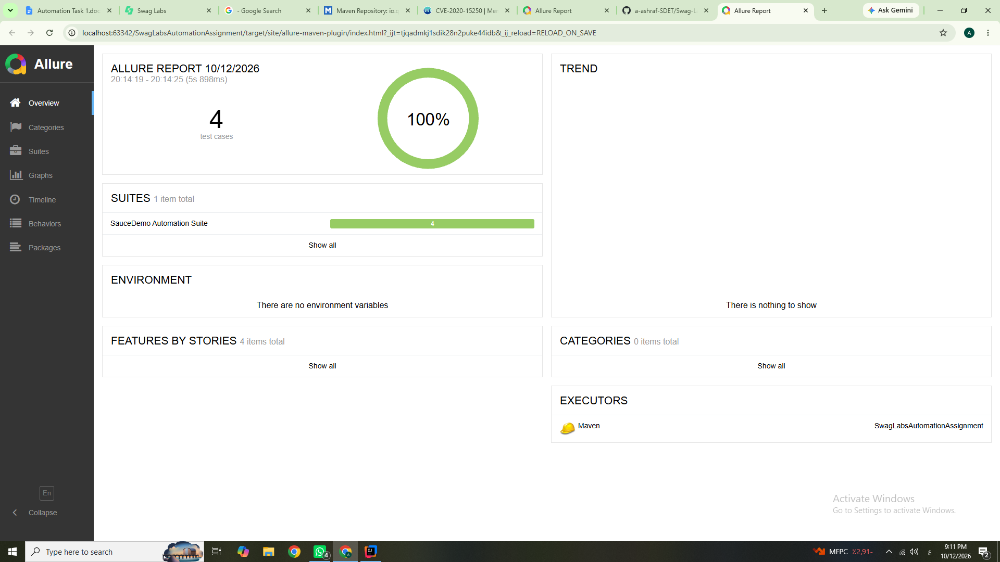

# Swag Labs Test Automation Assignment

A robust, enterprise-grade test automation framework built using **Selenium WebDriver**, **TestNG**, and **Google Gson** following the **Page Object Model (POM)** design pattern.

## Security & Architecture Decisions

### 1. Mitigation of Vulnerability (CVE-2020-15250)
Initially, the project considered using `json-simple` (v1.1.1) for externalizing data. However, during the architecture review, it was skipped due to safety and security configurations regarding **CVE-2020-15250**.
- **The Risk:** `json-simple` has known vulnerabilities where untrusted data parsing could lead to Denial of Service (DoS) or unexpected resource exhaustion.
- **The Solution:** Upgraded the framework to use **Google Gson (v2.14.0)**, which is actively maintained, secure, and production-safe against data-parsing exploits.

### 2. Clean Session Synchronization
To eliminate flaky test behavior and avoid the notorious `NoSuchSessionException` (invalid session id: session deleted), a **Clean Session Synchronization** strategy was implemented in the `BaseTest` configurations:
- Browser driver initializations are sandboxed per test method execution using isolated `ChromeDriver` instances.
- Added explicit synchronization capabilities using `ChromeOptions` (`--remote-allow-origins=*`) to safeguard websocket handshakes between Selenium and the Chrome renderer.
- Proper driver teardown logic ensures that no orphaned browser processes block socket connections for subsequent test cases.

### 3. Dynamic Explicit Wait Strategy
To handle modern asynchronous UI rendering and avoid brittle thread sleeps, the framework integrates localized synchronization wrappers via `WebDriverWait` paired with `ExpectedConditions`. Elements (such as the footer layout component) are evaluated dynamically based on visibility triggers before interactions or assertions are fired, completely eliminating timing discrepancies.

### 4. Mathematical Precision Framework
For e-commerce workflow stability, the framework incorporates an unformatted text-to-primitive parsing engine. It extracts localized currency representations (e.g., `$15.99`), strips formatting characters using regular expressions, and applies floating-point mathematical validation to verify subtotal summaries against independent calculation arrays.

---

## Project Structure
```text
SwagLabsAutomationAssignment/
├── .github/workflows/
│   └── allure.yml
├── testData/
│   └── testData.json
├── src/
│   ├── main/java/
│   │   ├── pages/
│   │   │   ├── LoginPage.java
│   │   │   ├── InventoryPage.java
│   │   │   ├── CartPage.java
│   │   │   ├── CheckoutPage.java
│   │   │   └── ProductDetailsPage.java
│   │   └── utils/
│   │       ├── DataDriven.java
│   │       └── WaitUtils.java
│   └── test/java/
│       ├── base/
│       │   └── BaseTest.java
│       └── tests/
│           ├── LoginTest.java
│           ├── InventoryTest.java
│           ├── ProductDetailsTest.java
│           └── CartTest.java
├── allure-report.png
├── pom.xml
└── testng.xml
```

---

## Test Coverage Matrix

| Test Suite | Test Case Name | Type | Validation Point |
| :--- | :--- | :--- | :--- |
| **Login Suite** | `testSuccessfulLogin` | Positive | Validates routing to `/inventory.html` on successful authorization. |
| **Login Suite** | `testInvalidLogin` | Negative | Asserts specific mismatch error message text block display. |
| **Login Suite** | `testLoginWithoutPassword` | Negative | Asserts missing credential handling alert layout. |
| **Inventory Suite**| `testInventoryPageElements` | Functional| Verifies structural items count (6 items) and active cart badge visibility. |
| **Product Suite**  | `testProductDetailsAndAddToCart` | E2E / Visual| Validates full image source string path matching and active session addition. |
| **Cart Suite** | `testSocialLinks` | Functional| Handles tab/window routing to verify href redirects for LinkedIn, Facebook, and Twitter. |
| **Cart Suite** | `testVerifyCartIsEmpty` | Functional| Asserts that the shopping cart starts with an explicit count of 0. |
| **Cart Suite** | `testAddSpecificProducts` | Data-Driven| Extracts list configurations from JSON to load 3 separate items and check array match. |
| **Cart Suite** | `testRemoveOneProduct` | Action / State| Dispatches explicit click handlers to remove an item, and triggers backward browser layout to check resets. |
| **Cart Suite** | `testVerifyCartTotalPrice` | Math / Flow| Performs floating-point primitive calculation addition across multiple products and matches subtotal. |
| **Cart Suite** | `testCheckoutWithAnEmptyCart` | Edge Case | Validates real application behavior allows forwarding empty states to checkout details page. |
| **Cart Suite** | `testCartStateAfterLogoutLogin` | Session Sync| Verifies that active cart states persist seamlessly across application logout and re-authentication cycles. |

---

## Dependency Technical Specs

| Dependency Name | Group ID | Artifact ID | Version  | Purpose |
| :--- | :--- | :--- |:---------| :--- |
| **Java JDK** | N/A | N/A | `25.0.3` | Core programming platform |
| **Selenium Java** | `org.seleniumhq.selenium` | `selenium-java` | `4.50.0` | Browser automation core |
| **TestNG** | `org.testng` | `testng` | `7.12.0` | Test runner & assertions engine |
| **Google Gson** | `com.google.code.gson` | `gson` | `2.14.0` | Secure Data-Driven JSON parsing |
| **Allure TestNG** | `io.qameta.allure` | `allure-testng` | `3.0.0` | Test reporting framework listener |
| **Allure Maven** | `io.qameta.allure` | `allure-maven` | `2.12.0` | Local HTML report generation plugin |

---

## Framework Features
- **Page Object Model (POM):** Strict structural isolation between test logic and UI elements.
- **Data-Driven Testing:** Production credentials and dynamic product assertions are securely isolated inside `testData/testData.json`.
- **Advanced Locators & Asserts:** Implemented dynamic XPath wrappers to perform full data verification, including pricing text, structure bounds, and element visibility checking.
- **Image Integrity Checks:** Automates web asset pipeline validation via raw HTML `src` parameter parsing to safeguard against broken visuals.
- **Window & Tab Handling:** Implemented active window handle switches to manage multi-tab execution during social link navigation tests.
- **Browser History Navigation:** Utilizes native browser history commands (`driver.navigate().back()`) to perform clean backward context switches while maintaining session tokens.
- **Multi-Type Assertion Engine:** Integrates a combination of string block boundaries matching, boolean state evaluations, and exact counts verification to provide comprehensive test feedback.

---

## Test Execution Report
Below is the execution dashboard demonstrating a **100% success rate** across all 12 components:

)

## Getting Started

### Prerequisites
- Java JDK 25
- Apache Maven

### How to Run Tests & Generate Reports Local View

#### Run Complete Suite:
```bash
mvn clean test allure:report
```

#### Run Specific Test Class (e.g., Cart Suite only):
```bash
mvn test -Dtest=CartTest
```

#### Viewing the Report:
Expand `target/site/allure-maven-plugin/index.html` and open it inside any browser to interact with the graphics suite.
